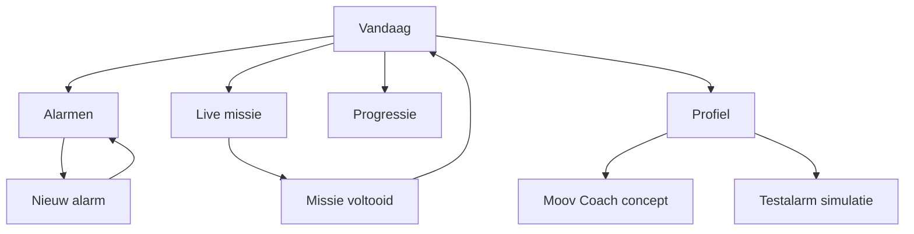

# Moov — schermen, componenten en interacties

Dit is de functionele overdracht van de **huidige ontwerp-demo**. De bron voor concrete JSX/HTML en mockdata is `prototype/app.js`. App-schermen worden client-side gerenderd vanuit één `state`-object. Hieronder alle schermen en gewenste overgangen.

## Navigatiekaart



De vaste bottom navigation bevat exact vier tabs: `Vandaag`, `Alarmen`, `Progressie`, `Profiel`. `Nieuw alarm` en `Live missie` zijn verdiepende flows zonder tabbar. `Moov Coach` is vanuit Profiel en de desktop-presentatienavigatie bereikbaar.

## 1. Vandaag — `home`

**Visuele compositie:** warme off-white pagina, kleine datumkicker linksboven, begroeting `Hey Hylke ✌️`, donkere ronde avatar `H`, grote tweeregelige titel `Let's get / moving.`.

1. **Streak-kaart:** donker, grote lime `12`, ernaast `DAGEN`, kleine outline-rotatiecirkels rechts en een stervorm.
2. **Volgende alarm:** sectiekop met link `Alle alarmen ↗`; lichtgroene kaart met grote `07:00`, `MA – VR`, tag `VERPLICHT`, label `Wake up & move`, `3 missies · Je start sterk`.
3. **Jouw ochtendmissie:** drie rijen: `01 Squats — 10 herhalingen`, `02 Bed opmaken — 1 handeling`, `03 Gordijnen open — 1 handeling`.
4. **CTA:** `Bekijk de missie-demo` brengt naar `mission`.
5. **Ondertekst:** `Ready to go. Je alarm-check is in orde.`

**Acties:** avatar naar Profiel; alle alarmen naar Alarmen; missie-CTA naar Live missie.

## 2. Alarmen — `alarms`

Header `STAY CONSISTENT` en `Mijn alarmen.`; ronde lime plus rechts. Beschrijving: `Jouw momenten om in beweging te komen. Kies zelf hoe streng Moov voor je is.`

Drie standaard mockalarmen:

| Tijd | Naam | Dagen | Niveau | Missies | Startstatus |
|---|---|---|---|---|---|
| 07:00 | Wake up & move | Ma – Vr | Verplicht | 3 | Aan |
| 11:30 | Active break | Elke werkdag | Uitstelbaar | 1 | Aan |
| 19:00 | Even stretchen | Ma, Wo, Vr | Flexibel | 2 | Uit |

Elke witte alarmkaart toont tijd, naam, dagen, niveau en missie-aantal. De toggle rechts zet de kaart aan/uit en vermindert bij uit de opacity. Onder de cards een donkere banner `Maak je eigen routine.` met lime plusknop.

**Acties:** plus of banner opent `editor`; toggle werkt lokaal, direct zichtbaar.

## 3. Nieuw alarm — `editor`

Teruglink naar Alarmen; heading `Nieuw alarm.`; centraal tijdveld in witte card (`07:00` standaard). Daarna:

1. Zeven dag-chips `M D W D V Z Z`, standaard maandag–vrijdag aan.
2. Vijf niveaukeuzes. Exacte beschrijvingen:
   - **Vrij:** Herinnering zonder druk. Je kunt stoppen of snoozen.
   - **Flexibel:** Je kunt verplaatsen naar een beter moment.
   - **Uitstelbaar:** Een paar keer snoozen, daarna echt beginnen.
   - **Verplicht:** Geen snoozen. Alle rondes afronden.
   - **Hardcore:** Maximale focus, inclusief wakker-check.
3. Zes oefenchips: `Squats`, `Push-ups`, `Jumping jacks`, `Plank`, `Bed opmaken`, `Gordijnen open`. Standaard Squats en Bed opmaken geselecteerd.
4. Brede lime CTA `Alarm opslaan`.

**Acties:** elke dag/chip is onafhankelijk selecteerbaar. Tijdstip mag bij selectie van niveau, dag of oefening niet worden gereset. Opslaan valideert minimaal één dag en één oefening en maakt een nieuw alarm aan in de lijst. In de demo heet dit `Mijn Moov-missie`, met de gekozen tijd/dagen/niveau/aantal missies. Toast: `Je nieuwe alarm staat in de lijst!`.

## 4. Live missie — `mission`

**Hele scherm donker**, statusbalk ook donker. Header `LIVE MISSIE / X VAN 3` met ronde sluitknop. Grote titel en korte coachtekst. Horizontale progressiestreep met drie segmenten.

### Ronde 1 — squats

- Titel `LET’S GO.`
- Omschrijving `Zak door je knieën en kom weer omhoog`.
- Camera-card `POSE DETECTION`, raster, neon-lime lijnfiguur met gewrichtspunten, hoekmarkeringen, bewegende scanlijn en `CAMERA PREVIEW · DEMO`.
- Grote teller `0 / 10`, statusbadge `BEZIG`.
- Voice strip met voorbeeldspraak, icon en donker olijfgroene achtergrond.
- CTA `Simuleer 5 herhalingen`: teller gaat 0 → 5 → 10. Daarna `Volgende ronde`.

### Ronde 2 — bed opmaken

- Titel `MAKE IT.`; omschrijving `Maak je bed netjes op`.
- Zelfde camera-card met bed-emoji in plaats van lichaamsfiguur.
- Teller `0 / 1`; CTA `Markeer als uitgevoerd`, daarna `Volgende ronde`.

### Ronde 3 — gordijnen open

- Titel `OPEN UP.`; omschrijving `Laat het daglicht binnen`.
- Zelfde camera-card met zon-emoji.
- Teller `0 / 1`; CTA `Markeer als uitgevoerd`, daarna `Rond missie af`.

### Afronding

- Groot rond lime succesicoon.
- Heading `YOU DID / IT.` met lime `IT.`.
- Tekst `Je hebt je hele ochtendmissie afgemaakt. Dat is hoe je een dag begint. 💪`.
- Twee statistieken: `12 DAGEN STREAK`, `3/3 MISSIES KLAAR`.
- CTA `Terug naar vandaag`.

**Overige acties:** ronde opnieuw (↺) zet de huidige teller op nul; sluiten en noodstop verlaten de demo. Camera-beeld en feedback zijn expliciet gesimuleerd.

## 5. Progressie — `progress`

Header `SHOW UP. LEVEL UP.` en `Progressie.`. Lime hero `12 DAGEN / ON FIRE.` met stervorm. Daaronder:

- `86%` missies voltooid, indicatie `+8%`.
- `124` reps deze week, indicatie `+22`.
- Weekgrafiek `19 – 25 OKT`, zeven verticale bars met relatieve hoogtes `[58,83,72,100,88,46,13]`; donderdag accent donker, andere bars grijzig groen.
- Badges: `⚡ Early mover`, `🔥 Streak master`, `🏆 Legend` (laatste uitgeschakeld/transparanter).

Dit is **mockdata**, geen doorgerekende productieanalytics.

## 6. Profiel — `profile`

Header `YOUR MOOV SPACE` en `Profiel.`. Donkere profielkaart `H`, `Hylke Thiry`, `Moov member · 12 dagen actief`.

Daaronder witte kaart `Alarm-check` met vier regels en groene checks:

- Meldingen — Toegestaan
- Alarmrechten — Toegestaan
- Camera — Toegestaan
- Niet storen test — Geslaagd

CTA `Simuleer testalarm ↗`. Onder de kaart instellingenrijen:

- Fysio & trainer → Moov Coach
- Mijn doelen — Iedere dag bewegen
- Meldingen — Ingeschakeld
- Privacy — Op je toestel

Onderaan een zichtbaar concept-disclaimer; deze waarden zijn niet gemeten.

## 7. Testalarm-overlay — `testOpen`

Een donkere fullscreen overlay met `MOOV SYSTEM CHECK`, grote lime `00:30`, heading `Even testen.` en korte uitleg. Primaire CTA `Test geslaagd` sluit de overlay en toont een toast. Dit is géén echte countdown of systeemrechtentest.

## 8. Moov Coach — `coach` (toekomstconcept)

Navigatie terug naar Profiel. Heading `Moov Coach.` en label `FUTURE FEATURE / V2`. Lichtblauwe hero `Jouw herstel. Jouw ritme.` met pill `BINNENKORT BESCHIKBAAR`.

Voorbeeldkaart `Schoudermobiliteit`, `Van je fysiotherapeut · 3× per week` met drie oefeningen:

- Arm circles — 2 × 12
- Wall slides — 3 × 10
- Shoulder stretch — 30 sec

Afsluitend `8/10 Sessies gedaan`, `80% therapietrouw`. Disclaimer dat behandelaarsportaal en gezondheidfuncties later komen. CTA `Houd me op de hoogte` toont een informatieve toast; geen echte registratie.

## 9. State en interacties

De huidige prototype-`state` bevat:

```js
{
  screen: 'home',
  alarms: [ /* drie standaardalarmen */ ],
  selectedDays: [0,1,2,3,4],
  selectedLevel: 'Verplicht',
  selectedExercises: ['Squats','Bed opmaken'],
  missionStep: 0,
  reps: 0,
  missionDone: false,
  testOpen: false,
  toast: ''
}
```

De click-handler staat in `prototype/app.js`. Neem de states en overgangen volledig over. De demo bewaart wijzigingen niet tussen reloads. Voor echte productie is opslag, notificaties, cameraservices en rechtencontrole extra werk.

## 10. Wat uit het productdocument buiten de huidige demo blijft

De grotere Moov-visie omvat kettingalarmen, AlarmKit en Niet-storen-permissies, slimme oefencontrole, abonnementen, buddies, agenda, fysiomodus en een webportaal. **Dat zijn productfeatures, niet vanzelf aanwezige functies in het visuele prototype.** Het MVP moet in het vervolgtraject worden afgebakend en platformmatig gevalideerd.
